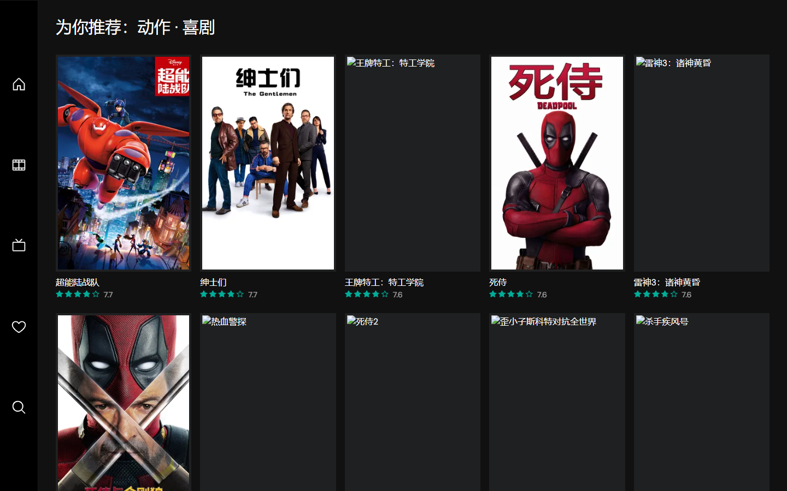

<br><p align="center">

</p>

<h1 align="center">wwwmovie · 电影浏览与类型榜单</h1>

<p align="center">
  <b>🔗 线上体验：<a href="https://wwwmovie-kr8s888.netlify.app">wwwmovie-kr8s888.netlify.app</a></b>
</p>




> 基于 [Nuxt](https://github.com/nuxt/nuxt) 的电影浏览网站，在 Nuxt 官方示例 [tastejs/nuxt-movies](https://github.com/tastejs/nuxt-movies)（MIT）基础上二次开发，数据来自 [The Movie Database (TMDB)](https://www.themoviedb.org) API。
>
> 技术栈：[Nuxt](https://github.com/nuxt/nuxt) · [Vue](https://github.com/vuejs/core) · [UnoCSS](https://github.com/unocss/unocss) · [Nuxt Image](https://image.nuxt.com) · [TypeScript](https://github.com/microsoft/TypeScript) · [Nitro](https://nitro.build)（代理层）

## 功能

- **首页 / 发现页**：热门、正在上映、即将上映、高分榜单
- **搜索**：电影与演员搜索
- **详情页**：电影详情（演员、剧照、相似推荐）、演员详情
- **类型榜单**（本项目新增）：多选类型（最多 3 个）→ TMDB `discover` 多类型 **AND 过滤** → **按加权评分（IMDb WR 公式）排序**，页面上会展示公式与参数（m / C / 候选数）

## 架构

```
浏览器  →  Nuxt 应用（单个部署：页面 + /tmdb 转发 + /ipx 图片优化）  →  TMDB API
```

页面、数据接口、图片优化都由**同一个应用**提供（`server/routes/tmdb`、`server/routes/ipx`），
因此线上只需一次部署、前后端同源无跨域；API Key 只存在于**服务端环境变量**，前端产物中不出现任何密钥。

> 仓库里另有一个独立的 `proxy/` 服务（上游结构），需要"独立代理 + 前端"的双服务部署时才用得上。

## 本地运行

前置条件：

- **Node.js 22+** —— `package.json` 的 `devEngines` 要求 Node `^24`，pnpm ≥ 10.14 会按需自动拉取匹配版本
- **pnpm 11** —— 推荐 `npm i -g pnpm@11.1.2`；用 corepack 时，Windows 上若报权限错误（`EPERM ... Program Files
odejs`）改用 `corepack enable --install-directory "$env:APPDATA
pm"`
- 一个免费的 TMDB API Key

```bash
# 1. 安装依赖
pnpm install

# 2. 配置密钥（项目根目录）
cp .env.example .env
# Windows PowerShell: Copy-Item .env.example .env
# 编辑 .env，把 TMDB_API_KEY= 后面填上自己的 Key（保存，不要加引号）

# 3. 启动
pnpm dev
```

打开 <http://localhost:3000>；类型榜单入口 <http://localhost:3000/preferences>。

> **只需要一个终端**：TMDB 代理与图片优化都由应用自己的 server routes 提供
> （`server/routes/tmdb/[...path].ts`、`server/routes/ipx/[...path].ts`），
> 所以本地开发和线上部署都不必单独启动代理服务。

TMDB Key 申请：<https://www.themoviedb.org/signup> 注册后到 <https://www.themoviedb.org/settings/api> 创建（选 Developer，用途随便填）。

```bash
# 生产模式本地验证（会自动读取根目录的 .env）
pnpm build && pnpm start
```

> 如果你的网络访问 `api.themoviedb.org` 异常（DNS 被污染），可在 `.env` 里加
> `TMDB_API_IP=<可用的真实 IP>`，服务端会直连该 IP（SNI/证书仍用域名）。
> 查询真实 IP：`curl.exe -s "https://doh.pub/dns-query?name=api.themoviedb.org&type=A"`

## 环境变量

| 位置 | 变量 | 说明 |
|---|---|---|
| `.env`（根目录） | `TMDB_API_KEY` | **必填**。应用内的 server routes 用它访问 TMDB；该文件已被 `.gitignore` 忽略 |
| `.env`（根目录，可选） | `TMDB_API_IP` | 本机 DNS 把 `api.themoviedb.org` 解析到被污染 IP 时，填一个可用真实 IP，服务端直连它 |
| `.env`（根目录，可选） | `BASE_URL` | 站点地址，默认 `http://localhost:3000` |
| 构建时（可选） | `VITE_API_BASE_URL` | 默认**同源**（走应用内 server routes）。仅在你想指向**外部独立代理服务**时才需要填写 |
| `proxy/.env` | `TMDB_API_KEY` | 只在你要单独跑仓库里那个独立 `proxy/` 服务时才需要 |

线上部署步骤见 **[docs/deploy-netlify.md](./docs/deploy-netlify.md)**（单站点，推荐）；
如果想用"独立代理 + 前端"的双服务架构，见 [docs/deploy-vercel.md](./docs/deploy-vercel.md)。

## 数据分析

除了站点本身，仓库里还有一层对 TMDB 数据的分析（`analysis/`，Python + pandas + matplotlib）：

- 采集 19 个类型的高票影片（**1201 部**），清洗后 **1190 部**进入分析
- 核心发现：**票数与评分的相关系数仅 0.352**（票多 ≠ 分高）；**加权评分榜与纯票数榜的 Top20 只有 8 部重合**
- 产出 6 张图表 + 分析报告：[docs/data-analysis.md](./docs/data-analysis.md)

```bash
python analysis/fetch_data.py   # 采集数据（TMDB API）
python analysis/analyze.py      # 清洗、统计、出图
```

## 我做了什么

> 边界说明：页面结构、UI 组件、TMDB 请求封装、i18n 框架与代理服务骨架来自上游示例（见文末 Credits）。以下是在此基础上的改动，都标了代码位置，方便核对。

### 1. 新增功能：类型榜单（多选 → 组合查询 → 加权评分排序）

- `app/pages/preferences.vue`：加载 TMDB 类型列表并网格多选，**上限 3 个**、**至少 2 个**才允许提交，跳转 `/recommend?genres=28,35&type=movie`
- `app/pages/recommend.vue`：在 setup 顶层用 `useAsyncData` 取数，展示榜单并显示所用算法与参数
- `server/api/recommend.get.ts`（新增）：榜单排序接口——先取 60 部高票候选池，再在服务端计算加权评分并整体重排
- `app/composables/tmdb.ts`：新增 `getRankedRecommendations()`

技术要点：

1. **多类型用 AND 语义**：TMDB `with_genres` 里多个 id 用 **`,` 连接表示 AND**（`|` 是 OR）——选"动作+喜剧"只会得到同时属于这两类的影片
2. **加权评分排序**：TMDB 只支持单字段排序，用平均分会让"票很少的冷门高分片"霸榜、用票数又全是商业大片；因此采用 IMDb Top 250 的加权评分公式
   `WR = (v / (v + m)) · R + (m / (v + m)) · C`（v 票数、R 平均分、m 最低票数门槛=500、C 候选池平均分）
3. **服务端重排 + 缓存**：TMDB 不支持按 WR 排序，所以先取候选池（按票数取前 3 页 = 60 部以保证票数达标），再本地重排，结果缓存 1 小时
4. **页面展示算法**：结果页直接显示公式与 `m`、`C`、候选数，排序逻辑对用户透明

### 2. 修复生产构建（开发模式正常、生产模式全站 500）

| 问题 | 根因 | 处理 |
|---|---|---|
| 生产下所有页面 500 | 上游依赖 `nuxt-nightly`，其 `precomputed` 数据在产物里是空桩 | 固定到稳定版 **Nuxt 4.5.2** |
| 运行时 `ERR_MODULE_NOT_FOUND` | `unhead` 声明 `^3.3.1` 被解析到 3.4.x，目录结构不兼容 | 在 `dependencies` 里显式钉死 **3.3.2**（只改 `pnpm.overrides` 会被 pnpm 11 跳过） |
| 产物缺 `unhead/dist` 文件 | Nitro 打包时依赖复制遗漏 | 新增 `scripts/fix-unhead-output.mjs`，挂到 `pnpm build` 之后自动补齐 |

完整的定位过程、命令与验证数据见 **[docs/troubleshooting.md](./docs/troubleshooting.md)**。

### 3. 开发环境与工程化

- 数据源从上游作者部署的代理切到本地代理：`apiBaseUrl` 改为 `http://localhost:3001`（`nuxt.config.ts`、`app/composables/tmdb.ts`）
- 品牌化：站点标题 / `titleTemplate` / description / `og:image` 改为 wwwmovie，页脚、`proxy/routes/index.ts`、`server/api/index.ts` 文案同步；移除指向上游的 `@nuxt_js` twitter 元信息
- i18n 精简：`locales` 从 14 个减到 **en + zh-CN**，删除其余 12 个语言包，并同步修改了 e2e 里写死 `fr-FR` 的语言切换断言
- 目录结构调整（去掉解压产生的嵌套层）、`.gitignore` 补齐、README 重写

### 4. 一次完整的网络层排障（DNS 污染）

本机无法访问 `api.themoviedb.org`，最终定位为 DNS 污染（域名被解析到 Meta 的 IP 段），用 DoH + Node 预加载模块覆盖解析解决，未改任何系统设置。同机对比：**修复前 10.7s 失败 → 修复后 688ms 成功**。过程见 [docs/troubleshooting.md](./docs/troubleshooting.md)。

## Credits & License

- 上游项目：[tastejs/nuxt-movies](https://github.com/tastejs/nuxt-movies)（官方示例），更早的原型 [jasonujmaalvis/vue-movies](https://github.com/jasonujmaalvis/vue-movies)
- License：[MIT](./LICENSE)（保留上游 `Copyright (c) 2022-present - Nuxt Team` 声明）
- 数据来源：


Data provided by [The Movie Database](https://www.themoviedb.org).

This project uses the TMDB API but is not endorsed or certified by TMDB.
