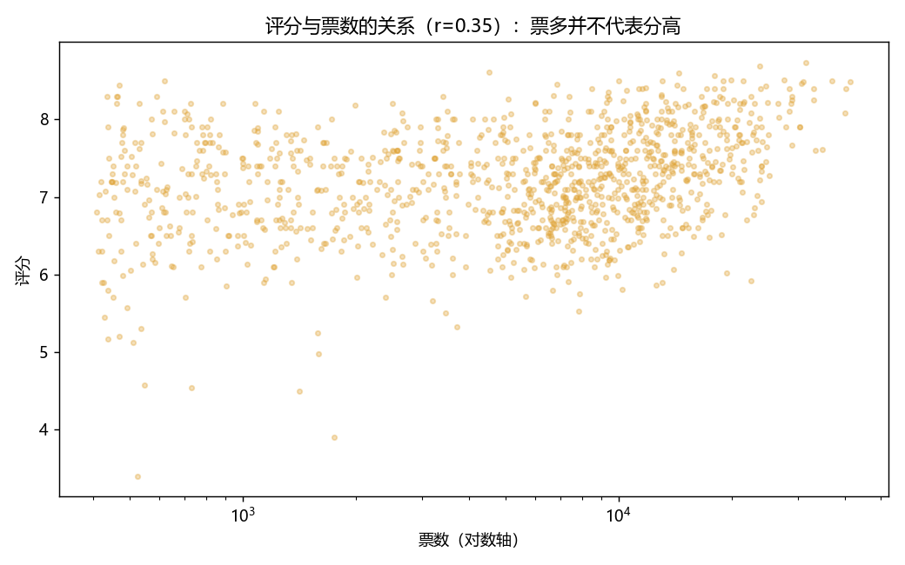
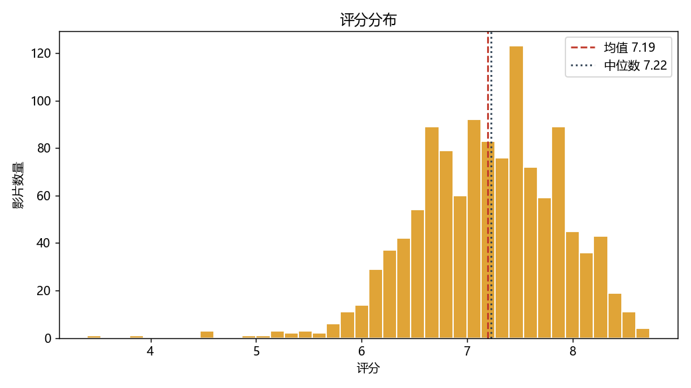
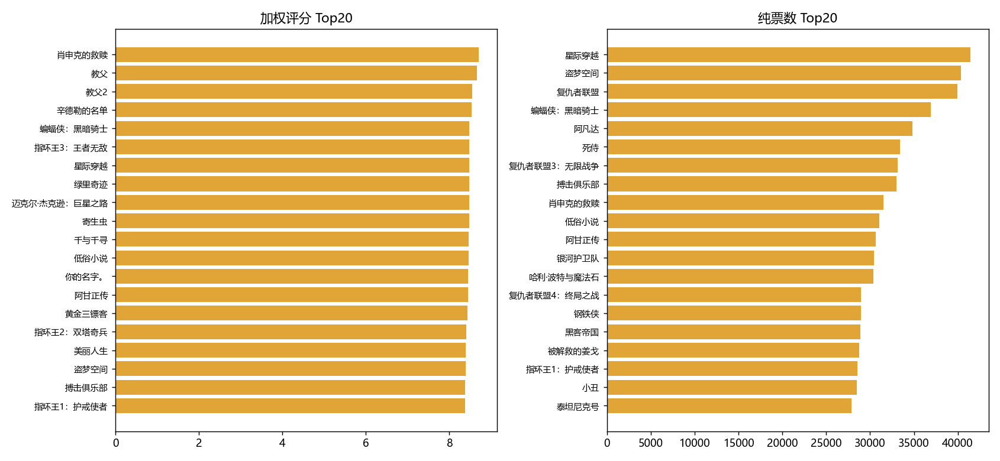
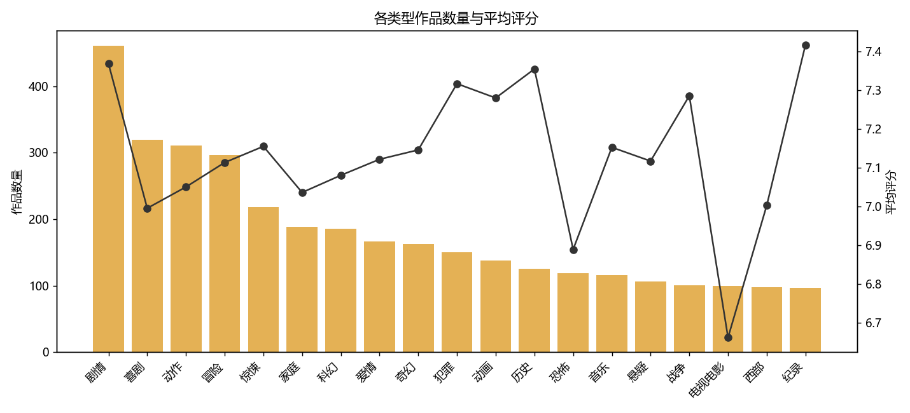
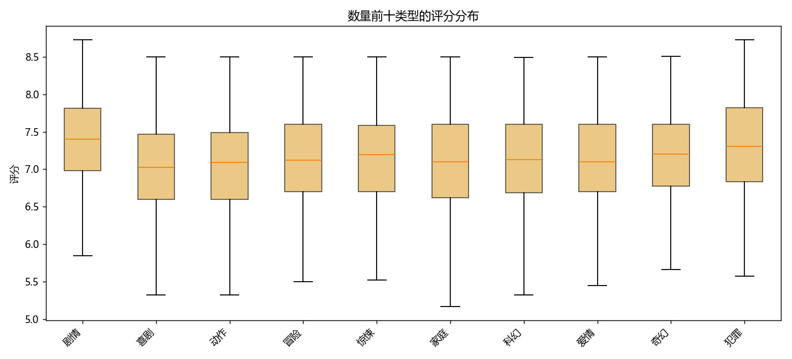
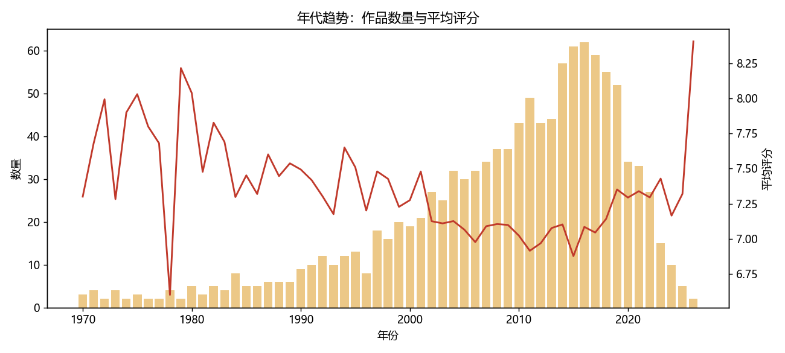

# 数据分析：TMDB 高票电影数据集

对这个站点背后的数据做的一层分析，回答两个问题：

1. 电影的类型、评分、票数之间到底是什么关系？
2. 站点里的「加权评分榜单」，相比直接按票数排序，差异有多大？

> 采集与分析代码在 [`analysis/`](../analysis/) 目录，按 `analysis/README.md` 可完整复现。

## 一、数据与方法

| 项 | 说明 |
|---|---|
| 数据来源 | TMDB API（`discover/movie`） |
| 采集方式 | 19 个电影类型 × 每类型按票数取前 5 页 ≈ 1900 条，按 id 去重 |
| 原始样本 | **1201 部** |
| 清洗口径 | 剔除缺评分/票数的记录；年份限定 1950–2030；票数 ≥ 50 过滤长尾 |
| 分析样本 | **1190 部** |
| 派生字段 | 年份（从上映日期提取）、加权评分 WR（与站点算法一致，m = 500） |
| 工具 | Python + pandas + matplotlib |

> **样本偏差**：这是"高票影片"子集（每类型取票数头部），不代表 TMDB 全库分布；结论适用于"热门影片"范围。

## 二、主要发现

### 1. 票数与评分几乎无关（r = 0.352）

相关系数只有 **0.352**（弱正相关），散点在对数横轴上相当弥散 —— **票多并不代表评分高**。
这正是站点不采用"按票数排序"的原因：那样只会把"看的人多、评价一般"的商业片顶到最前。

### 2. 评分集中在 7 分附近，基准分 C = 7.193

1190 部高票影片的平均分 **7.19**、中位数 **7.22**，分布近似正态、低分侧有长尾。
这个均值就是站点加权评分公式里的基准分 **C**，最低票数门槛 **m = 500**。

### 3. 加权评分榜与纯票数榜差异显著（Top20 仅 8 部重合）

同一份数据、两种排序，Top20 **只有 8 部重合（40%）**：

- **纯票数榜**：清一色高票房商业大片
- **加权评分榜**：评分高且票数达标的影片 ——《肖申克的救赎》WR 8.708、《教父》8.657、《十二怒汉》8.532、《蝙蝠侠：黑暗骑士》8.483

也就是说：**排序策略的差异，实质性改变了 60% 的榜单结果**。

### 4. 类型的产量与口碑不成正比

| 平均分最高 | 平均分最低 |
|---|---|
| 纪录 7.42（97 部） | 电视电影 6.66（100 部） |
| 剧情 7.37（461 部） | 恐怖 6.89（119 部） |
| 历史 7.35（125 部） | 喜剧 7.00（319 部） |
| 音乐 7.32（150 部） | 爱情 7.00（98 部） |

**产量最高的类型（剧情 461 部、喜剧 319 部）平均分都不突出**，而纪录片、历史这类小产量类型口碑更好。

### 5. 类型内部的评分离散度差异明显

### 6. 年代趋势：产量集中在近 20 年，老片平均分更高

## 三、结论：它如何影响站点设计

1. **票数不能当作质量代理**（r = 0.352）→ 站点用加权评分而非票数排序
2. **加权评分让榜单"换血"约 60%**（Top20 仅 8 部重合）→ 证明排序策略是实质性设计决策，而非装饰
3. **基准分 C 用数据算出来（7.193）**，而不是拍脑袋取值；`m = 500` 的含义是：票数低于 500 的影片，其评分会被明显"拉向"全样本均值

## 四、局限与可扩展方向

- **选择偏差**：样本是"高票头部"子集（已用票数 ≥ 50 过滤长尾），不能代表全库
- **语言偏向**：TMDB 以英语片为主，中文片覆盖不完整
- **可扩展**：引入用户行为（收藏/点击）做个性化排序；用 TMDB `keywords` 计算影片相似度，做基于内容的推荐
